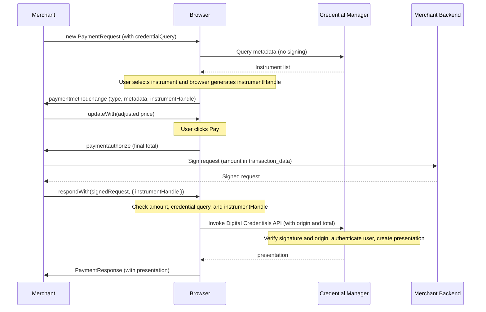

# Digital Credential Payment Method explained

## tl;dr

**Digital Credential Payment Method** is a proposed payment method for the
[Payment Request API] that enables merchants to accept payments backed by
digital credentials — in any format reachable through the
[Digital Credentials API], including Verifiable Credentials and ISO/IEC
18013-7 mdoc — by leveraging the Payment Request API's checkout
orchestration. It bridges the Payment Request API's checkout capabilities
(price negotiation, shipping, contact collection) with the
[Digital Credentials API]'s credential presentation.

The method allows merchants to dynamically adjust prices based on the selected
payment instrument (e.g., surcharges for certain card types, discounts for bank
transfers) and ensures cryptographically-bound transaction authorization through
signed presentation requests.

See also:
  - [W3C Payment Request API](https://www.w3.org/TR/payment-request/)
  - [W3C Digital Credentials API](https://w3c-fedid.github.io/digital-credentials/)
  - [ISO/IEC 18013-7 mdoc](https://www.iso.org/standard/82772.html) and
    [W3C Verifiable Credentials Data Model](https://www.w3.org/TR/vc-data-model-2.0/)
    are two example credential formats reachable through the Digital
    Credentials API; this explainer is format-agnostic and uses the
    neutral term *presentation* for the credential manager's response.

## Contents

- [Motivation](#motivation)
  - [Goals](#goals)
  - [Non-Goals](#non-goals)
- [Proposed Solution: Digital Credential Payment Method](#proposed-solution-digital-credential-payment-method)
  - [Proposed APIs](#proposed-apis)
    - [Creating a PaymentRequest](#creating-a-paymentrequest)
    - [Handling instrument selection (paymentmethodchange)](#handling-instrument-selection-paymentmethodchange)
    - [Handling authorization (paymentauthorize)](#handling-authorization-paymentauthorize)
  - [User Experience in Failure Modes](#user-experience-in-failure-modes)
- [Other Considerations](#other-considerations)
  - [Relationship to the Payment Request API](#relationship-to-the-payment-request-api)
  - [Metadata interface design](#metadata-interface-design)
  - [Relationship to Secure Payment Confirmation](#relationship-to-secure-payment-confirmation)
- [Alternatives Considered](#alternatives-considered)
  - [Plain Digital Credentials API](#plain-digital-credentials-api)
  - [Custom checkout flows using HTML, JS, and CSS](#custom-checkout-flows-using-html-js-and-css)
- [Security Considerations](#security-considerations)
  - [Cross-origin considerations](#cross-origin-considerations)
  - [Nonce and replay prevention](#nonce-and-replay-prevention)
  - [Signed request validation](#signed-request-validation)
  - [Credential substitution protection](#credential-substitution-protection)
- [Privacy Considerations](#privacy-considerations)
  - [Fingerprinting via metadata](#fingerprinting-via-metadata)
  - [canMakePayment() behavior](#canmakepayment-behavior)
  - [Instrument enumeration protection](#instrument-enumeration-protection)
  - [Correlation attacks](#correlation-attacks)

## Motivation

Payment instruments are increasingly being modeled as digital credentials —
in formats such as W3C Verifiable Credentials and ISO/IEC 18013-7 mdoc.
There is a desire by websites to both accept these credentials as payment,
and use them for other purposes such as authentication.

While the Digital Credentials API (`navigator.credentials.get()`) can retrieve
such credentials, it lacks the checkout orchestration capabilities that
e-commerce requires:

1. **No price negotiation**: The Digital Credentials API is a one-shot request.
   The merchant cannot adjust prices based on which credential the user selects
   (e.g., applying a discount for bank transfers).

2. **No fulfillment handling**: Real-world checkout requires collecting shipping
   addresses, calculating taxes, and gathering contact information. The Digital
   Credentials API does not model this.

3. **No deferred signing**: Merchants often need to sign the final presentation
   request only after the price is negotiated. The Digital Credentials API
   expects a fully-formed request upfront.

The Payment Request API already solves most of these orchestration problems and
provides additional capabilities that complete the checkout experience:

1. **Price negotiation**: The `paymentmethodchange` event lets merchants adjust
   prices based on the selected instrument.
2. **Fulfillment collection**: Built-in support for shipping addresses, contact
   information, and tax calculation.
3. **Retry support**: `PaymentResponse.retry()` lets the merchant request
   corrections (e.g., a different shipping address or instrument) without
   tearing down the checkout flow.
4. **Built-in payments UI**: Browsers render a consistent, platform-integrated
   payment sheet.
5. **Established user trust patterns**: Users already recognise the payment
   sheet as the trusted surface for authorising a payment.
6. **Error handling flow**: The API defines a structured error model
   (e.g., `AbortError`, `SecurityError`) that integrates with the checkout
   lifecycle.

What Payment Request lacks today is a **deferred authorization hook** — a step
after the user clicks "Pay" (once the final amount is locked in) where the
merchant can sign the presentation request before the credential manager is
invoked, or decline the transaction via `event.decline()`.

Rather than re-defining payment-specific logic inside the Digital Credentials
API, we can re-use what Payment Request already provides and add a single
`paymentauthorize` event to bridge the two.

### Goals

Find a solution that:

* Enables merchants to accept presentations from a credential manager
  as payment instruments, through familiar Payment Request
  integration patterns.
* Allows price negotiation based on selected payment instrument type (e.g.,
  surcharges, discounts, incentives).
* Supports cryptographically-bound transaction authorization through signed
  presentation requests.
* Enables browsers to reuse the Payment Request UI and lifecycle for
  digital credential-based payments, letting users fall back to other payment
  methods offered in the same `PaymentRequest` when they have no matching
  credential. By design, the merchant can't detect that case.
* Preserves user privacy by limiting metadata exposure and preventing
  instrument enumeration.

### Non-Goals

* Definition of specific credential types or formats (e.g., what a
  hypothetical payment-card credential looks like).
* Credential issuance or provisioning flows.
* Using credentials to provide fulfillment information (e.g., shipping
  addresses, phone numbers), which can already be collected through Payment
  Request's existing mechanisms. While credentials could potentially supply
  this information, this is out of scope for the current proposal and may be
  introduced in a future version.

## Proposed Solution: Digital Credential Payment Method

Digital Credential Payment Method (DCPM) introduces a new payment method,
`digital-credential-payment`, that combines the Payment Request API's checkout
orchestration with the Digital Credentials API's credential presentation.

The flow works as follows:

1. The merchant creates a `PaymentRequest` with a DCQL query describing the
   credentials it accepts (no amount, nothing signed yet).
2. The browser displays the payment sheet, populated with the instruments from
   platform credential managers that match that query.
3. When the user selects an instrument, the merchant receives a
   `paymentmethodchange` event with non-PII metadata and an ephemeral
   `instrumentHandle` token, and can adjust pricing.
4. When the user clicks "Pay", the merchant receives a `paymentauthorize` event
   and calls `respondWith()` with a **signed** presentation request, which
   carries the final amount as OpenID4VP payment transaction data, and the
   `instrumentHandle` as a separate option.
5. The browser checks that the signed request's amount matches the total and
   that it asks for the same credentials as the original query, and verifies
   the `instrumentHandle` against the selected instrument. It then routes the
   request to the selected credential manager via the Digital Credentials API,
   passing along the requesting origin and the total.
6. The credential manager verifies the signature and origin, shows the user the
   amount, authenticates them, and returns a presentation bound to the amount
   (e.g., an SD-JWT VC presentation, or an mdoc `DeviceResponse`).
7. The merchant receives the presentation and processes the payment.



### Proposed APIs

This method introduces a new event, `paymentauthorize`, that fires when the user
confirms payment but before the Digital Credentials API is invoked. This allows
the merchant to provide a signed presentation request with the final,
negotiated amount.

#### Creating a PaymentRequest

The merchant describes the credentials it accepts as a DCQL query (Section 6
of [OpenID4VP](https://openid.net/specs/openid-4-verifiable-presentations-1_0.html))
when constructing the `PaymentRequest`. The browser reads each query's
`format` and type constraint (e.g., `vct_values`, `doctype_value`) to decide
which instruments to show; it does not evaluate claims. The query carries no
amount, so no placeholder total is needed. Later, the signed request's
`dcql_query` must equal this query, so the instruments the user chose from
are the ones the final request asks for. Every query must keep cryptographic
holder binding (the DCQL default); without it, a presentation isn't bound to
the request's nonce and can be replayed.

```javascript
const credentialQuery = {
  credentials: [
    {
      id: "card",
      format: "dc+sd-jwt",
      meta: { vct_values: ["https://credentials.example/payment-card"] }
    },
    {
      id: "bank",
      format: "mso_mdoc",
      meta: { doctype_value: "org.example.bank-account.1" }
    }
  ]
};

const request = new PaymentRequest([{
  supportedMethods: "digital-credential-payment",
  data: { credentialQuery }
}], {
  total: { label: "Total", amount: { currency: "USD", value: "100.00" } }
});
```

#### Handling instrument selection (paymentmethodchange)

When the user selects a payment instrument, the merchant receives a
`paymentmethodchange` event with credential type, non-PII metadata, and an
ephemeral `instrumentHandle` token. The merchant can adjust pricing based on this
information and captures the `instrumentHandle` for use during authorization:

```javascript
let currentInstrumentHandle = null;

request.onpaymentmethodchange = (event) => {
  if (event.methodName !== "digital-credential-payment") return;

  const { type, instrumentHandle } = event.methodDetails;

  // Capture the instrumentHandle — it binds the merchant's authorization
  // to this instrument when passed to respondWith() later.
  currentInstrumentHandle = instrumentHandle;

  // `type` is the id of the merchant's own credential query that the
  // instrument matched ("card" or "bank" above).
  const adjustment = type === "bank" ? -2.00 : 0; // $2 bank transfer discount

  event.updateWith({
    total: { label: "Total", amount: { currency: "USD", value: (100 + adjustment).toFixed(2) } },
    displayItems: [
      { label: "Subtotal", amount: { currency: "USD", value: "100.00" } },
      ...(adjustment !== 0 ? [{
        label: "Bank Transfer Discount",
        amount: { currency: "USD", value: adjustment.toFixed(2) }
      }] : [])
    ]
  });
};
```

#### Handling authorization (paymentauthorize)

When the user clicks "Pay", the browser fires a `paymentauthorize` event. The
merchant provides a fully-signed presentation request with the final amount,
and passes the `instrumentHandle` from the selected instrument as a separate
argument:

```javascript
request.onpaymentauthorize = (event) => {
  // The signing endpoint builds and signs the final presentation request
  // from the merchant's own order state: the payment transaction_data entry
  // for the total, the same DCQL query, and a fresh nonce (see "Nonce and
  // replay prevention" below). It rejects the call if the reported total
  // does not match that state. The client sends only an order reference
  // and the total it expects, so the endpoint cannot be used to sign
  // arbitrary requests. It responds with, e.g.,
  //   { protocol: "openid4vp-v1-signed", data: { request: "eyJhbGciOi..." } }
  // instrumentHandle does not need to round-trip through the signing
  // server: it is a UA-issued token validated by the UA when passed to
  // respondWith().

  // respondWith() is called synchronously during event dispatch.
  // Pass a promise; if it rejects, the payment sheet returns to READY.
  const signedRequestPromise = fetch("/api/sign-presentation-request", {
    method: "POST",
    body: JSON.stringify({
      orderId,
      amount: event.total.value,
      currency: event.total.currency
    })
  }).then(r => {
    if (!r.ok) throw new Error("Signing failed");
    return r.json();
  });

  event.respondWith(signedRequestPromise, {
    instrumentHandle: currentInstrumentHandle
  });
};
```

When authorization succeeds, `show()` resolves with a `PaymentResponse` whose
`details` is `{ protocol, data }`: the presentation protocol, and the credential
manager's response, encrypted to the merchant. The merchant forwards `data` to
its server to decrypt and verify, including checking the transaction data hash
that binds the amount.

### User Experience in Failure Modes

Below are different failure modes and the corresponding expected user
experience.

#### No Matching Instruments

When no instruments in any discovered credential manager match the merchant's
credential query:

* If the `PaymentRequest` offers other payment methods that appear in the sheet,
  the browser may leave the `digital-credential-payment` option out. The user
  pays another way or cancels, and the merchant sees the same outcomes as for a
  user who had matching instruments and chose not to use them.
* If it's the only method, it **still appears** and its payment sheet is still
  presented, showing no available instruments. The user can only cancel, which
  rejects `show()` with an `AbortError` — exactly as for a user who had matching
  instruments but declined.

When it's the only method, it deliberately does **not** remove itself from the
payment sheet. Doing so would leave an otherwise-empty sheet and cause `show()`
to reject with `NotSupportedError`, which a merchant could observe to detect that
the user holds no matching instrument. Collapsing the no-match case to the same
`AbortError` as a decline keeps the two indistinguishable, preserving the
anti-enumeration guarantees. (Whether the method is offered at all is decided
separately by the *steps to check if a payment can be made*, which depend only
on browser/platform support — never on whether the user holds a matching
instrument.)

The empty sheet is also a chance for the browser to explain why nothing is
available and how the user might add a suitable credential to a credential
manager. That guidance stays inside the sheet: if the user leaves to follow it,
`show()` rejects with the same `AbortError` as any other cancellation, so the
merchant learns nothing new.

#### Authorization Timeout

When the merchant does not respond to the `paymentauthorize` event within the
timeout period (recommended: at most 30 seconds), the browser:

* Displays a timeout notice to the user
* Returns to the ready state so the user can try again; `show()` stays pending
  and a late response is ignored

#### Signed Request Validation Failure

When the signed presentation request fails the browser's checks, the browser
does not route it to the credential manager, closes the payment sheet, and
rejects `show()`:

* With a `SecurityError` for a mismatch: the payment transaction data amount
  doesn't equal the total, the request's `dcql_query` doesn't equal the
  original credential query, or the `instrumentHandle` doesn't match the
  selected instrument.
* With a `TypeError` for a malformed or unsupported request: an unsigned or
  unknown protocol, a request the browser can't decode, or a missing payment
  transaction data entry.

Neither allows retry, since both indicate a merchant bug or a tampered
request. See [Signed request validation](#signed-request-validation).

#### Credential Manager Authentication Failure

When the user fails to authenticate with the credential manager (e.g., biometric failure),
the browser may:

* Allow the user to attempt authentication again depending on platform conventions
* Return to the ready state so the user can try again

OpenID4VP wallets report errors as a *successful* Digital Credentials API
response containing an `error` code. The browser treats `access_denied` (the
user declined, has no matching credential, or failed to authenticate) like a
cancellation, and closes the sheet with an `OperationError` for any other code.
It never passes the code to the merchant, because a code can reveal which
credentials the user holds.

#### Merchant-Initiated Decline

When the merchant calls `event.decline(reason)` during authorization,
the browser:

* Displays the provided reason to the user
* Returns to the ready state to allow retry

## Other Considerations

### Relationship to the Payment Request API

This proposal introduces a new event, `paymentauthorize`, that fires after
the user clicks "Pay" but before the `show()` promise resolves — a window
the Payment Request API does not expose to other payment methods today.
The event fires only when the user pays with the `digital-credential-payment`
method. The `onpaymentauthorize` attribute is still present on every
`PaymentRequest`, so merchants can feature-detect support.

The Payment Request API doesn't currently define a point between the user
clicking "Pay" and the request being accepted where a payment method can run
asynchronous steps like these. The specification flags this as an open issue
for coordination with the Web Payments Working Group. If the Payment Request
API later adds a general authorization hook for all payment methods, this
specification will move to it.

### Metadata interface design

The browser obtains instrument information through a metadata interface whose
transport is platform-specific but whose data is defined by the spec. For each
instrument, the credential manager provides a record with:

* An opaque, credential-manager-scoped identifier, used to constrain the final
  request to that instrument and never shown to the merchant
* The credential's format and type, used to match it against the merchant's
  credential query
* A display name and thumbnail image, shown only in the payment sheet
* Payment attributes (network, instrument category, funding type, account type)
  from which the browser derives the merchant-facing metadata

Implementations are expected to pre-synchronize these records, so that `show()`
doesn't wait on the credential manager and its timing doesn't reveal how many
instruments the user has. No signing or credential access happens during
browsing. The browser exposes only the derived, non-PII metadata to the
merchant; there is no merchant-facing display label.

### Relationship to Secure Payment Confirmation

[Secure Payment Confirmation (SPC)](https://www.w3.org/TR/secure-payment-confirmation/)
provides strong authentication for existing payment methods (e.g., card-on-file
transactions) using WebAuthn credentials. DCPM, by contrast, handles payment
using digital-credential-based instruments where the credential itself
represents a payment capability.

The two specifications are complementary:

* **SPC** authenticates a user for an already-established payment instrument
  using a FIDO credential. The payment instrument is managed by a payment
  service provider.
* **DCPM** orchestrates checkout using a digital credential as the payment
  instrument itself. The credential is managed by a credential manager and presented via
  the Digital Credentials API.

A merchant could support both: SPC for traditional card authentication and
DCPM for digital-credential-based payment methods, potentially within the
same `PaymentRequest` as separate `supportedMethods` entries.

## Alternatives Considered

### Plain Digital Credentials API

Using `navigator.credentials.get()` directly for payment credentials was
considered but rejected because:

1. **No price negotiation**: The API is one-shot; the merchant cannot adjust
   prices after seeing which credential type the user selected.

2. **No fulfillment handling**: Shipping addresses, taxes, and contact
   information cannot be collected through the Digital Credentials API.

3. **Poor conversion**: Without a familiar checkout flow, users may abandon
   transactions or be confused by the unfamiliar UX.

### Custom checkout flows using HTML, JS, and CSS

Merchants could build custom checkout flows with their own instrument selection
UI, but this approach:

* Fragments the payment experience across sites
* Requires each merchant to solve the same orchestration problems
* Cannot access platform credential manager integration
* Provides no consistent security guarantees

## Security Considerations

### Cross-origin considerations

A presentation must be usable only by the origin that requested it. Rather
than checking merchant identity itself, the browser relies on the binding the
Digital Credentials API and OpenID4VP already provide:

* The browser passes the requesting origin to the credential manager, as the
  Digital Credentials API does for any request.
* For signed OpenID4VP requests, the credential manager checks that origin
  against the request's `expected_origins` and refuses the request if it isn't
  listed.
* The credential manager binds the presentation to the origin (the audience is
  `origin:<origin>`, even for signed requests), and the merchant's server
  verifies it.

This prevents **merchant spoofing**: a malicious site can't replay another
merchant's signed request, because that request lists only the genuine
merchant's origins. The browser doesn't interpret the request's `client_id`;
OpenID4VP client identifiers carry prefixes (`x509_san_dns:`,
`decentralized_identifier:`, …) whose verification belongs to the credential
manager's trust framework.

### Nonce and replay prevention

Replay protection comes from the presentation protocol. OpenID4VP requires the
merchant to create a fresh, cryptographically random nonce for every request
and store it with its session, and requires the credential manager to bind the
presentation to that nonce and to the origin. The merchant's server checks both.

Every authorization attempt, including a retry, obtains a fresh signed request
and so a fresh nonce. Because the amount is also bound into the presentation
as payment transaction data, a captured presentation can't be reused to
authorize a different amount.

### Signed request validation

The final request must use a signed protocol (`openid4vp-v1-signed`,
`openid4vp-v1-multisigned`, or `org-iso-mdoc` with reader authentication).
For OpenID4VP, the request object is a JWS whose payload is base64url-encoded
JSON, so the browser can read it without the merchant's key and without
parsing any credential format. It doesn't verify the signature; the credential
manager does. The browser checks that:

* The request contains exactly one payment transaction data entry, and its
  amount equals the current total surfaced in `PaymentAuthorizeEvent.total`.
* The request's `dcql_query` equals the `credentialQuery` the merchant gave
  at construction, so the instruments the user chose from are the ones the
  request asks for.

Because the credential manager verifies the signature over the same payload
the browser decoded, a request that passes these checks carries, under the
merchant's signature, the total the user saw. For `org-iso-mdoc`, the browser
can't read the amount, so only the credential manager's comparison with the
total the browser passes along applies.

`instrumentHandle` is **not** part of the signed request. It is supplied via
the second argument to `respondWith()` and checked as soon as dispatch
completes.

The credential manager's authentication ceremony, which renders the claims
about to be disclosed before the user authenticates, remains the
authoritative consent surface for what is released.

If validation fails, the browser closes the sheet and rejects `show()`
with a `SecurityError` (mismatch) or `TypeError` (malformed or unsupported
request), and does not allow retry.

### Credential substitution protection

An attacker might attempt to substitute a different credential during the
Digital Credentials API flow than the one displayed during checkout. This
specification provides two complementary layers of protection:

**Selection binding (instrumentHandle):** When the user selects an
instrument, the browser generates an ephemeral, opaque `instrumentHandle` token
and provides it to the merchant via `paymentmethodchange`. The merchant
passes this token as the second argument to `respondWith()`. Before
invoking the Digital Credentials API, the browser verifies that the
`instrumentHandle` matches the currently selected instrument. This ensures
the merchant's pricing decision (which may depend on instrument type) is
bound to the instrument that will actually be used. Because `instrumentHandle`
is not part of the signed payload, the browser does not need to parse
the merchant's request to perform this check.

**Browser-to-credential-manager binding (opaque, credential-manager-scoped handle):** The browser also
passes an internal instrument identifier to the Digital Credentials API that
the merchant never sees. The credential manager resolves this to the correct credential
internally. This prevents substitution at the credential manager layer.

## Privacy Considerations

### Fingerprinting via metadata

The metadata object in `paymentmethodchange` events could enable fingerprinting
if not carefully constrained. The browser is the enforcement point — it
mediates between the platform metadata interface and the merchant page —
and is responsible for:

* Filtering exposed values to coarse-grained categories with high entropy
  overlap across users. `fundingType` and `accountType` are closed
  enumerations defined by the spec (`FundingType`, `AccountType`), so their
  values are fixed; `network` and `instrumentType` are drawn from a finite,
  browser-controlled set per field. Values from the platform metadata
  interface that are not valid for a field are dropped rather than surfaced
  to the merchant. `network` and `instrumentType` are not yet enumerated by
  the spec; a registry is the intended long-term solution for them.
* Stripping high-cardinality fields (exact institution, BIN range, card art)
  before they cross the merchant boundary, even if the platform metadata
  interface produced them.
* Showing the credential manager's display name and thumbnail image only in
  the payment sheet. There is no merchant-facing display label, so no
  platform-provided string crosses the merchant boundary.
* Disclosing metadata only when the user *selects* an instrument. Because the
  merchant may need it to adjust the price, it arrives before the user confirms
  payment: a user who selects an instrument and then cancels has still
  disclosed it.

### instrumentHandle privacy properties

The `instrumentHandle` token is designed to avoid introducing new tracking
vectors:

* It is ephemeral — a new value is generated each time the user selects an
  instrument, with no persistence across sessions or page loads
* It is opaque — it encodes no information about the instrument, credential,
  credential manager, or user
* It is non-correlatable — values cannot be linked across origins, sessions,
  or transactions
* It is a version 4 UUID ([RFC 9562](https://www.rfc-editor.org/rfc/rfc9562)) —
  a fresh, uniformly-random value, so it carries no fingerprinting signal

### canMakePayment() behavior

`canMakePayment()` resolves via the method's *steps to check if a payment can
be made*: it returns `true` if the browser supports the method and the metadata
interface is available. It does **not** return `false` based on whether the
user has matching instruments, as this would enable fingerprinting through
probing — and, as noted above, a user with no matching instrument still sees the
method and an empty sheet rather than its absence.

Merchants cannot assume `canMakePayment() === true` guarantees a successful
payment flow.

### Instrument enumeration protection

User agents prevent merchants from inferring the number of available
instruments:

* `paymentmethodchange` events fire only after explicit user interaction
* Only the currently selected instrument's metadata is revealed
* Event timing does not reveal instrument count
* Whether the user browsed other instruments is not exposed

### Correlation attacks

Merchants might attempt to correlate users across sessions using presentation
contents. Mitigation responsibility splits across three actors:

* The **credential format**: the chosen format (e.g., mdoc, OpenID4VP)
  determines whether persistent identifiers can be omitted from a presentation,
  and whether selective disclosure is supported. Format choice is the
  primary lever; this specification cannot make non-correlation properties
  hold for a format that does not support them.
* The **credential manager**: when the format supports it, the credential manager uses selective
  disclosure to omit identifiers not required by the merchant's request,
  and emits per-origin pseudonymous identifiers rather than stable subject
  IDs.
* The **browser**: passes the requesting origin to the credential manager,
  which binds the presentation to it, so a malicious origin cannot harvest
  presentations intended for a different origin.

[Payment Request API]: https://www.w3.org/TR/payment-request
[Digital Credentials API]: https://w3c-fedid.github.io/digital-credentials/
