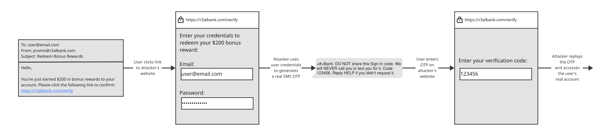
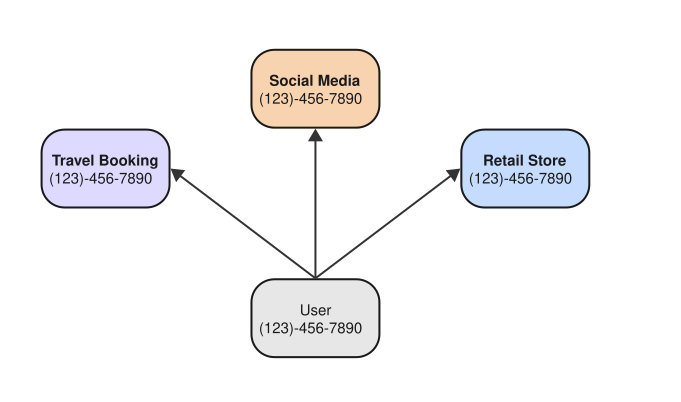
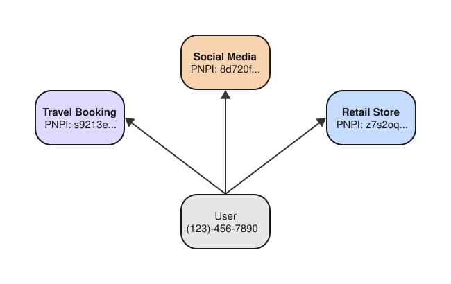

# Phone Number Possession API

Proving possession of a phone number is commonly used for user authentication and account recovery. Phone numbers are closely tied to a person’s identity. The same phone number sticks around with a person and serve as a stable identifier for many years, or even decades. Phone numbers are also are invaluable in preventing the creation of spam and bot accounts due to the difficulty of aquiring a new phone number compared to the difficulty of creating a new email address.

## Issues with SMS-Delivered Verification Codes

A common flow for user authentication on the web is to verify that a person receives a verification code through an out of band channel, often a text message sent over SMS or RCS. If the user can successfully echo the code back to the website, they are successfully authenticated.

Although web browsers on some platforms have smoothed over this authentication flow somewhat with an AutoFill capability, it can’t improve the speed and reliability of text message delivery, and doesn’t address phishing.

### Phishing

If an attacker wanted to take control of a user’s account, they could try to acquire the verification code sent in the text message to the user’s phone number. Attackers can obtain the verification code using social engineering. This can look like sharing the code on a scam voice call or entering it on an attacker controlled website. The attacker can then present the code to the real website as if they were the legitimate user.



### Privacy

Sending verification codes in text messages requires the website or an affiliated party to store the user’s phone number. The website may not need the phone number for any purpose other than authentication. Since a phone number is a stable, long-lived identifier, it is a powerful tool for tracking a user’s online presence.



### Awkward user interaction

In addition, having to enter a verification code from a text message isn’t always the most seamless experience from the user’s end and can break the authentication flow.  In the worst case scenario, a user has to leave whatever app they were using, go to their text messaging app, wait a few seconds for the code to arrive, and then copy and paste or type out the code that they received. In addition, the text message may never arrive, arrive late, or require the user to request a new one, leading to confusion.

Browsers have smoothed over this authentication flow thanks to AutoFill features which handle the retrieval of the verification code. However, while this accelerates the manual work needed to retrieve the code, it does nothing to help with the speed, reliability, or phishability problems with SMS-delivered codes.


## Phone Number Possession Identifier (PNPI)

This proposal outlines a new method of performing phone number verification that is resistant to phishing and easy to use while enabling improved user privacy by allowing websites to make use of possession of a phone number without having to request and retain phone numbers.

A website can request an identifier which represents the possession of a phone number, scoped to that website (or relying party). This identifier is called the **Phone Number Possession Identifier (PNPI)**.

The PNPI is useful for authentication as it **remains stable for a single user**, just like a phone number. To authenticate a user, the website can verify that the PNPI from the person authenticating matches the PNPI they have on record. Concretely, the PNPI is a 32 byte value, accompanied by a proof of ownership of that value.

### Phishing resistant

Unlike SMS-delivered verification codes, using PNPI never requires a user to type in a code. In fact, the user never sees the PNPI itself, preventing a whole class of phishing attacks. The PNPI is sent directly from the browser to the website, leaving no avenue for it to be intercepted “over the wire”.

### Privacy-preserving

Many websites verifying possession of a phone number don’t require knowledge of the phone number itself, a sensitive piece of Personally Identifiable Information (PII). As such, a website can choose to verify the user’s possession of their phone number, without learning the phone number itself. 

When a website wishes to authenticate a user using their PNPI, they have two modes available:

1. Verify user’s possession of a stable phone number over time **without learning** the phone number
2. Verify the user’s possession of a particular phone number

Authenticating with a PNPI neutralizes the threat of cross-site tracking. Unlike a phone number, a single user’s PNPI is different for every website they use it with. In other words, PNPIs are origin-scoped.




### Seamless User Interaction

The user doesn’t need to leave the website since the entire authentication ceremony happens in the browser. There’s no need to switch to another messaging app and manually enter a code.

## Use Cases

### Sign-in,  authentication, validation, and verification

Today, many websites use verification codes as a step to verify a person before a critical action such as making a payment, modifying account settings, or just accessing protected resources.

PNPI verification works in a similar way. Websites can perform PNPI verification once in order to enroll a user account, recording the PNPI value, comparable to enrolling a phone number for SMS verification. On subsequent authentication, a website can perform PNPI verification again, verifying the PNPI value matches the one they have on record.

For sites that have existing users’ phone numbers, they can request **both** a PNPI and phone number at the same time. This allows the site to relate the user’s phone number with their new PNPI. After this point, future requests can be PNPI-only.

### Account Recovery

Similar to text verification codes, PNPI can be used for account recovery. For example, if a user has lost access to their password or passkey for a service, they can fall back to a previously-established PNPI as a way to authenticate or recover an account. PNPIs are not bound to any particular device or platform. They are ultimately controlled by the user’s carrier and as-recoverable-as the backing phone number.

## High-Level Flow of the Protocol

Authentication with a PNPI is accomplished by using a new, multi-party protocol involving a relying party (RP), cell phone carriers, and optionally, a party serving the “aggregator” role, which facilities an RP’s scaling to support many carriers.

The PNPI protocol is a multi-party ceremony whose details are beyond the scope of this explainer. In the future, we will share a draft of the specification.

Here is a high-level overview of the protocol works:

1. The RP asks the client to perform PNPI verification. The user must consent to the PNPI request to proceed.
2. The client authenticates to the carrier using its SIM, and asks the carrier to provide a per-session credential. This credential is bound to the underlying phone number. During this interaction, the carrier doesn’t learn what website the user was trying to authenticate with.
3. The carrier returns the per-session credential to the client
4. The client takes this credential from the carrier and locally combines it with the identity of the site. This creates the PNPI which is per (phone-number, origin) pair. The client also makes an assertion that the PNPI was created from the credential that the carrier issued. This assertion is a Zero Knowledge Proof (ZKP).
5. The website receives a response from the client which contains the PNPI and the ownership assertion. However, the response is encrypted. To read the response, a decryption key is needed from the carrier. 
6. If the RP has direct relationships with the carrier, the RP can directly to the carrier to obtain the decryption key. If not, the RP can optionally reach out to another party called an aggregator to retrieve the decryption key. This may trigger a billing event between the RP and the aggregator.
7. The carrier/aggregator provides the decryption key.
8. The RP is able to decrypt the PNPI and ownership assertion. They verify the legitimacy of the ownership assertion. In the case of verifying a returning user, the RP checks that the new PNPI matches the user’s previous PNPI.

### Carrier migration

When a user switches carriers, their PNPI will stay the same, but the public key of the carrier that signs the credential will change. If a website sees a carrier public key that it doesn’t recognize, the website should provide the optional “knownCarrierPubKey” field in the request. This will cause the browser to populate the “portingZKP” field of the response, which contains a proof that states that the user’s previous carrier authorized migration to their new carrier, creating a continuous chain of trust.

## API Proposal

## **Request:**

```webidl
partial dictionary CredentialRequestOptions {
    PhoneNumberPossessionRequestOptions phoneNumberPossessionIdentifier;
};

dictionary PhoneNumberPossessionRequestOptions {
    // The site provides a challenge to verify that the
    // result is from this session and not a previous one.
    required BufferSource challenge;
    
    // Optional domain string to identify the relying
    // party who is requesting proof of phone number possession.
    // Useful in the case of subdomains.
    // https://www.w3.org/TR/webauthn-2/#rp-id
    USVString rpId;
    
    // Type of responses the site can ask to receive.
    required PhoneNumberPossessionResponseType desiredResponseType;
    
    // Optional hint as to which phone number the site wishes to verify.
    // This string should contain only digits.
    DOMString phoneNumberSuffixHint;
    
    // Optional hint as to which PNPI the site wants to verify. 
    // This is useful in re-verify flows where the RP already 
    // has a record of the user’s PNPI and can help the platform
    // surface the correct phone number, such as for multi-SIM
    // users, or flag that the expected PNPI isn't available.
    BufferSource PNPISuffixHint;
    
    // Optional key which the RP provides based on the last carrier
    // they know this user was subscribed to. This is useful for
    // allowing the platform to notice when a user ports their
    // phone number to a new carrier and automatically providing a
    // "porting proof" in the response.
    BufferSource knownCarrierPubKey;
};
    
    
enum PhoneNumberPossessionResponseType {
    “possession-identifier”,
    “possession-identifier-and-phone-number”,
};
```


## **Response:**

```webidl
[Exposed=Window, SecureContext]
interface PhoneNumberPossessionCredential : Credential {    
    // Resolves with false if the call to navigator.credentials.get()
    // will certainly fail.
    static Promise<boolean> isAvailable();
      
    // This encrypted payload contains the
    // PNPI token itself and a zero knowledge
    // proof that proves the PNPI was created
    // for this rpId using a credential signed by
    // the carrier’s private key.
    // This payload can be decrypted
    // once the website reaches out to the aggregator
    // to acquire the decryption key and
    // trigger a billing event.
    // Once decrypted the payload contains the two fields:
    //     1. the PNPI (called Phone Number Possession Identifier) 
    //        is a SHA256 hash (32 bytes long) of an RP identifier 
    //        and a seed signed by the carrier
    //     2. a zero knowledge proof that the same carrier associated
    //        with carrierPubKey signed a specific seed needed to created
    //        this specific PNPI
    readonly attribute ArrayBuffer encryptedPNPIWithProof;
    
    // Additional data the site needs to send back to the
    // aggregator to get back the key to decrypt
    // the encryptedPNPIWithProof field.
    // This is a UTF-8 serialiazed JSON which will 
    // contain one of the following two fields:
    //   1. "decryptionKey": contains the symmetric
    //       encryption/decryption key which 
    //       encryptedPNPIWithProof was encrypted with.
    //       This field is a JSON array of bytes.
    //   2. "error": Error details, including whether 
    //       the request can be retried.
    //       This is a JSON String containing the error type.
    //       Either "permanent", "transient", or "none"
    // If an error ocurrs, the aggregator should not 
    // record a billing event.
    readonly attribute ArrayBuffer? encryptedDecryptionKeyOrError;
    
    // Public key of the carrier which attested
    // possession of a certain phone number.
    // The algorithm and format of this key are determined
    // by the carrier.
    readonly attribute ArrayBuffer? carrierPubKey;
    
    // Optional part of the response if the site
    // requested a desiredResponseType of
    // “possession-identifier-and-phone-number”.
    // This contains the phone number in MSISDN
    // format.
    // This is encrypted with the same encryption
    // key as encryptedZKPEncryptionKey.
    readonly attribute ArrayBuffer? encryptedMSISDN;
    
    // UTF-8 JSON serialization of CollectedClientData with
    // the following format:
    //  {
    //    "challenge": (string) base64url of the request's challenge
    //                 without padding,
    //    "rp_id": (string) the relying party ID the request was made for
    //    "context": (string) "web browser" for browsers, 
    //                otherwise the calling app's identifier,
    //    "responseType": (string) which type of desiredResponseType was requested,
    //    "version": (number) protocol version. must be 1 for v1
    //  }
    readonly attribute ArrayBuffer clientDataJSON;
    
    // Proof that the user has ported their number
    // between carriers. Only provided when the request
    // includes the "knownCarrierPubKey" field.
    readonly attribute ArrayBuffer? portingZKP;
};
```

## Example Usage

```javascript
if (!await PhoneNumberPossessionCredential.isAvailable())
  return fallBackToSMS();

const credential = await navigator.credentials.get({
    phoneNumberPossessionIdentifier: {
        challenge: "ksvp0PD7GDD2clXa2iDnUA",
        rpId: "login.example.com",
        desiredResponseType: "possession-identifier",
        pnpiSuffixHint: new Uint8Array([0x48, 0x3f, 0x6c ... ]),
        knownCarrierPubKey: lastKnownCarrierKey
    }
});

// Query the aggregator for the decryption key or error information.
// Receiving a decryption key should trigger a billing event.
const decryptionKey = await billAndFetchDecryptionKey(credential.encryptedDecryptionKeyOrError);

const [pnpi, zkProof] = decryptAndUnpack(credential.encryptedPNPIWithProof, decryptionKey);

if (!validateClientDataJSON(credential.clientDataJSON)) {
    return error();
}

if (!zkProof.validate(credential)) {
    return error();
}

if (pnpi != previouslyKnownPnpi) {
    return error();
}

return authenticate();
```

## Alternatives Considered

### Digital Credentials

We considered using the Digital Credentials Web API as a carrier for PNP requests. Digital Credentials are designed to allow for offline presentment credentials between multiple parties (e.g. presenting a claim about a mobile driver’s license to a website). Due to the nature of the PNV problem space, we wouldn’t make use of that capability, while absorbing significant complexity.

### HTML element

We considered a `<phoneverification>`  HTML element which would be able to participate in form submission. We strayed away from this option since we wanted to give web developers the flexibility to add phone number verification wherever they see fit in their authentication flows, which is easier with the JavaScript API.

## Phone Number Possession API and WebAuthn

WebAuthn, which brings passkeys to the web, allows for a strong, phishing-resistant credential that's saved to a user's credential manager. Passkeys, conveyed to the web via WebAuthn, are the industry's phishing-resistant and easy-to-use replacement for passwords.

For the most common threat models, we believe a passkey is sufficient to provide strong security for online accounts. Even in a world with widespread adoption of a strong, phishing-resistant credential like a passkey, some relying parties may wish to provide additional security via a signal that’s independent from a user’s access to a passkeys in a credential manager. A user’s possession of a phone number may be independent from access to a saved credential. In addition to this authentication benefit, some relying parties and their users who are using passkeys may benefit from using possession of a phone number over time as an account recovery mechanism.
